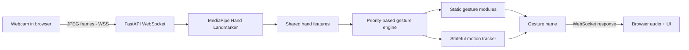
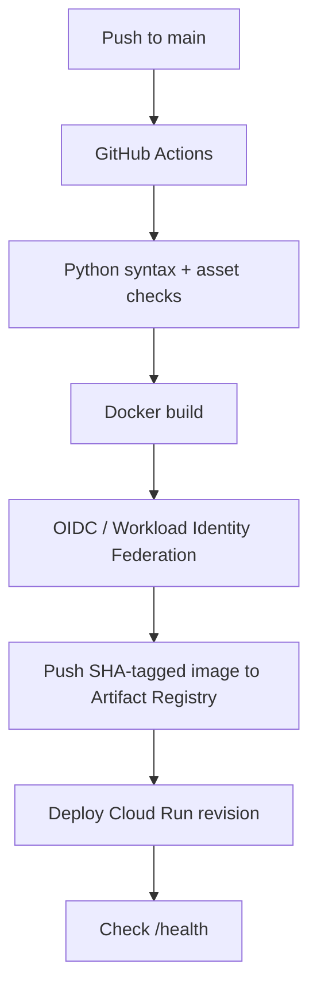

<div align="center">

# ✋ Gesture Soundboard

### Real-time hand gestures. Instant reactions. A little bit of chaos.

**A browser-based computer-vision experiment powered by MediaPipe, FastAPI and WebSockets — containerised with Docker and continuously deployed to Google Cloud Run.**

[](https://github.com/Roofus002/gesture-soundboard/actions/workflows/deploy-cloud-run.yml)


**[🚀 Launch the live demo](https://gesture-soundboard-79446848790.australia-southeast1.run.app/)** · **[⚙️ Deployment workflow](https://github.com/Roofus002/gesture-soundboard/actions)**

</div>

---

## 💡 The idea

What started as a goofy webcam soundboard evolved into a small but complete **real-time computer-vision application**. The browser captures camera frames, sends compressed images over a WebSocket, and receives gesture classifications from a Python backend. Each recognised gesture triggers a sound effect in the browser.

The interesting engineering isn't a new hand-tracking model: **MediaPipe provides the landmarks**. This project focuses on making those landmarks useful in a responsive, modular, cloud-deployed application.

### What it recognises

| Gesture | Recognition approach | Reaction |
| :--- | :--- | :--- |
| 🖕 Middle finger | Static finger-angle rules | Plays the corresponding novelty sound |
| ✊↔️ Horizontal fist shake | Stateful motion tracking across frames | Plays a separate sound effect |
| ✊ Closed fist | Static pose recognition | Shows a detection status while tracking motion |
| ✋ Other/no recognised gesture | Default state | Returns to normal |

> **Heads-up:** This is a playful demonstration, not an accessibility tool or sign-language translator. More gestures and an optional professional sound profile are future ideas, not existing features.

## 🧠 How it works



**Key design decisions**

- **One MediaPipe inference per frame.** The backend extracts hand landmarks once, then reuses the resulting features across gesture recognisers.
- **Modular recognition.** Independent gesture modules keep the core detector from becoming a long chain of hardcoded conditions.
- **Per-connection state.** Each WebSocket connection gets its own `GestureEngine`, including its own fist-motion history.
- **Motion over time.** The fist tracker looks for horizontal changes in direction, tolerates brief detection gaps, and uses a cooldown to prevent rapid retriggering.
- **Backpressure on the client.** The browser aims for roughly eight frame submissions per second, with at most one frame awaiting a response when the request-in-flight guard is enabled.

## 🧰 Technology stack

| Layer | Technology | Why it's here |
| :--- | :--- | :--- |
| Computer vision | **MediaPipe Hand Landmarker** | Detects hands and their landmarks |
| Frame processing | **OpenCV + NumPy** | Decodes JPEG frames and calculates geometry |
| API | **Python 3.12 + FastAPI** | Hosts the application and WebSocket endpoint |
| Real-time transport | **WebSockets (`ws` / `wss`)** | Persistent bidirectional frame/results exchange |
| Frontend | **HTML, CSS, JavaScript** | Camera capture, status UI and audio playback |
| Packaging | **Docker** | Reproducible runtime environment |
| Hosting | **Google Cloud Run** | Managed container execution and HTTPS ingress |
| Registry | **Artifact Registry** | Stores versioned Docker images |
| Automation | **GitHub Actions + Google Cloud OIDC** | Build, authenticate and deploy on push to `main` |

## 🗂️ Project structure

```text
mediapipe_finger/
├── Dockerfile
├── requirements.txt
├── models/
│   └── hand_landmarker.task
└── web_demo/
    └── backend/
        ├── app.py                    # HTTP routes + WebSocket
        ├── hand_detector.py          # MediaPipe inference
        ├── hand_features.py          # Shared landmark-derived features
        ├── gesture_engine.py         # Priority-based gesture routing
        ├── gestures/
        │   ├── __init__.py
        │   ├── middle_finger.py       # Static recogniser
        │   └── fist_shake.py         # Motion tracker
        └── frontend/
            ├── index.html
            ├── styles.css
            ├── script.js
            └── assets/
                ├── FU.mp3
                └── gawk.mp3

.github/workflows/
└── deploy-cloud-run.yml
```

## 🚀 Run it locally

**Requirements:** Python 3.12, a webcam, and a modern browser. Docker is optional.

From the repository root:

```powershell
python -m venv venv
.\venv\Scripts\Activate.ps1
pip install -r .\mediapipe_finger\requirements.txt
cd .\mediapipe_finger\web_demo\backend
python -m uvicorn app:app --host 127.0.0.1 --port 8080
```

Open **http://127.0.0.1:8080**, select **Start Camera**, and grant webcam permission.

Alternatively, run the container from the repository root:

```bash
docker build -t gesture-soundboard ./mediapipe_finger
docker run --rm -p 8080:8080 gesture-soundboard
```

The application provides:

- `GET /` — browser interface
- `GET /health` — lightweight health endpoint
- `WS /ws` — streaming JPEG frames in and gesture labels out

## 🔄 CI/CD: from commit to Cloud Run



The workflow in [`.github/workflows/deploy-cloud-run.yml`](.github/workflows/deploy-cloud-run.yml) uses **short-lived Google Cloud credentials via Workload Identity Federation** rather than a committed service-account key. Images are tagged with the Git commit SHA, making deployments traceable.

> The current workflow checks Python syntax, required assets and image buildability. A broader automated test suite is a planned improvement.

## 🧩 Challenges solved

<details>
<summary><b>Running MediaPipe inside a slim Docker image</b></summary>

A minimal Python image lacked native libraries required by OpenCV/MediaPipe. Adding the required EGL, GL, GLib and audio-related packages allowed the application to start in the container.

</details>

<details>
<summary><b>Getting WebSockets working in production</b></summary>

The ASGI server needed WebSocket protocol support. Using `uvicorn[standard]` enabled the persistent browser-to-server connection.

</details>

<details>
<summary><b>Making motion recognition reliable</b></summary>

A single missed fist detection originally reset the movement sequence. Tolerance for short tracking interruptions, a tunable travel threshold, and a cooldown made the interaction more usable.

</details>

<details>
<summary><b>Eliminating manual cloud deployments</b></summary>

GitHub Actions now builds and deploys the application after changes are pushed to `main`. The pipeline authenticates to Google Cloud through OIDC instead of storing long-lived keys.

</details>

## 🔒 Privacy & security notes

- The browser requests **camera access**; it does **not** request microphone access.
- Camera frames are transmitted to the backend for inference. The current application does not intentionally persist those frames.
- The public Cloud Run endpoint uses **HTTPS/WSS**, with TLS terminated by Google's frontend; the container listens on an internal HTTP port.
- This is a **public, unauthenticated hobby demo**. Server-side size limits, rate limiting, improved input validation and richer observability are worthwhile future hardening tasks.
- Camera performance and recognition accuracy vary with lighting, framing and movement speed.

## 🛣️ Roadmap

- [x] Browser webcam capture and real-time WebSocket exchange
- [x] Middle-finger recognition and audio feedback
- [x] Modular hand-feature extraction and gesture engine
- [x] Stateful horizontal fist-shake recognition
- [x] Docker + Cloud Run deployment
- [x] GitHub Actions CI/CD with OIDC
- [ ] Thumbs-up and two-handed heart recognition
- [ ] Professional / fun sound profiles
- [ ] Repeatable unit and integration tests
- [ ] WebSocket input limits and connection management
- [ ] Improved UI and gesture recognition diagnostics

## 👨‍💻 About the project

Built by **Tharuka Weerasinghe** as a hands-on exploration of real-time computer vision, Python backend engineering, containerisation, and cloud deployment.

**[Try the demo](https://gesture-soundboard-79446848790.australia-southeast1.run.app/)** · **[View the source](https://github.com/Roofus002/gesture-soundboard)**

---

<div align="center"><sub>Powered by existing computer-vision models. Built to learn how real-time applications work end to end.</sub></div>
